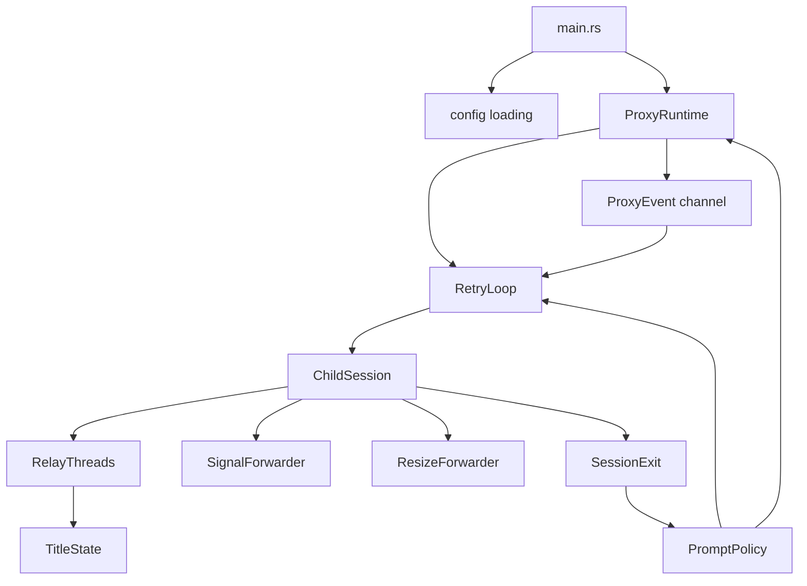
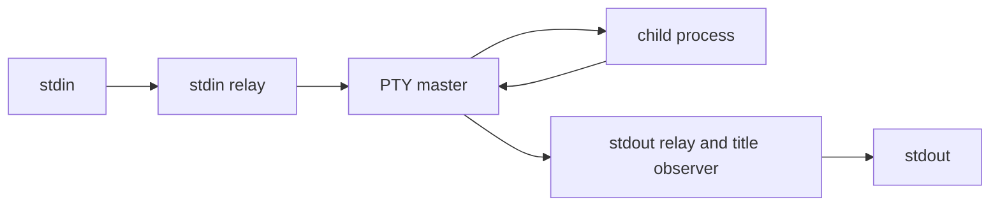
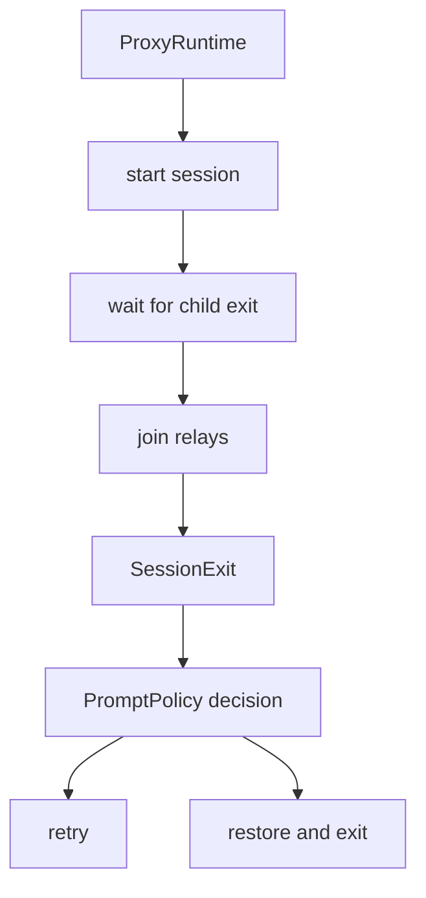
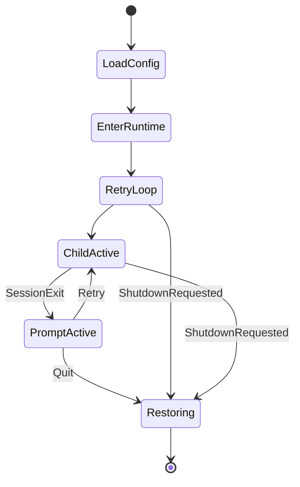
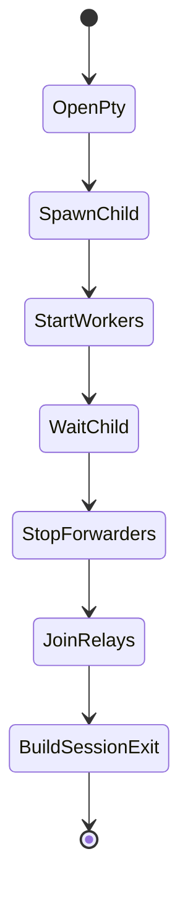

# child-session orchestration design

## Summary

This design refactors title-proxy around explicit ownership of the child-session lifecycle. The MVP implementation works, but [`run_child_session`](/src/proxy.rs#L140-L262) owns too many unrelated resources at once: PTY setup, child process state, duplicated file descriptors, relay threads, signal forwarding, resize forwarding, title state, exit-status mapping, and helper-thread cleanup.

The new design keeps the project's best constraint: no async runtime. PTY I/O remains blocking. Relay workers remain ordinary `std::thread` threads. The change is structural. Each resource with a distinct lifetime gets a small owner, and the retry loop receives a typed `SessionExit` summary instead of reaching into shared thread state.

The design also folds in three related architectural moves within limits. A process-level runtime guard owns raw terminal mode and shutdown restoration. A `src/lib.rs` boundary exposes the functional core and session contracts for tests. A small event-channel control plane is introduced now for signal and prompt coordination, but it remains deliberately narrow: blocking PTY I/O stays in worker threads, and the channel does not become a general async runtime.

This is a follow-on design to [`doc/design/2026-06-08-title-proxy.md`](/doc/design/2026-06-08-title-proxy.md). It does not replace the MVP behavior. It makes the implementation easier to reason about before adding richer retry, prompt, and signal policy.

## Goals

1. Make terminal restoration a process-level lifecycle guarantee.
2. Split child-session orchestration into owned components with narrow responsibilities.
3. Preserve blocking I/O and avoid an async runtime.
4. Replace shared title-state return values with a typed `SessionExit` summary.
5. Move prompt and retry decisions toward pure policy functions.
6. Add a library boundary so integration tests can import core behavior directly.
7. Add a minimal event coordinator for signals, prompt keys, shutdown requests, and child-exit notifications without introducing async I/O.

## Non-goals

1. Do not add persistence, history, database storage, or network behavior.
2. Do not introduce Tokio, async I/O, or a general PTY framework.
3. Do not change OSC parsing semantics except where type boundaries require moving code.
4. Do not redesign terminal rendering or track full screen state.
5. Do not add a large plugin/config system as part of this refactor.

## Definition of done

The refactor is complete when title-proxy has the same user-visible MVP behavior and the following structural properties:

1. `main.rs` is a small entry point that delegates to library modules.
2. A process-level runtime guard owns raw-mode restoration for normal exit, prompt exit, and handled shutdown signals.
3. Command configuration is validated into a `CommandSpec` before session startup.
4. `ChildSession` owns the active PTY child, process group identity, PTY file descriptors, and last observed title state.
5. `RelayThreads` owns relay worker handles and classifies normal vs abnormal relay termination.
6. `SignalForwarder` owns per-session signal forwarding to the child process group.
7. `ResizeForwarder` owns per-session `SIGWINCH` propagation to the child PTY.
8. `run_child_session` is replaced by smaller components and returns `SessionExit`.
9. Prompt and retry decisions are represented as testable policy functions.
10. Tests cover terminal restoration, session exit summaries, relay cleanup, and signal/resize ownership boundaries.

## Acceptance criteria

### session-orchestration.AC1: behavior preservation

- **session-orchestration.AC1.1 Success:** `title-proxy -- bash` remains an interactive PTY relay.
- **session-orchestration.AC1.2 Success:** child output and title-setting OSC sequences still pass through unchanged.
- **session-orchestration.AC1.3 Success:** child exit still shows the retry prompt.
- **session-orchestration.AC1.4 Success:** pressing space still reruns the same command.
- **session-orchestration.AC1.5 Success:** pressing `q` still restores the terminal and exits successfully.

### session-orchestration.AC2: runtime guard

- **session-orchestration.AC2.1 Success:** raw mode is entered through one process-level owner.
- **session-orchestration.AC2.2 Success:** normal exit restores the original termios.
- **session-orchestration.AC2.3 Success:** Ctrl+C at the retry prompt restores the original termios and exits with code 130.
- **session-orchestration.AC2.4 Success:** handled shutdown signals restore the original termios before exit.
- **session-orchestration.AC2.5 Edge:** the panic hook is either removed or changed to restore the saved original termios rather than applying raw mode.

### session-orchestration.AC3: command validation

- **session-orchestration.AC3.1 Success:** empty commands are rejected before opening a PTY.
- **session-orchestration.AC3.2 Success:** non-empty config command data becomes a `CommandSpec` with `program` and `args` fields.
- **session-orchestration.AC3.3 Success:** retry uses the same validated `CommandSpec`, not repeated slicing of `Vec<String>`.

### session-orchestration.AC4: child session ownership

- **session-orchestration.AC4.1 Success:** `ChildSession` owns the child process handle until wait completes.
- **session-orchestration.AC4.2 Success:** PTY file descriptor duplication and ownership are localized to session setup.
- **session-orchestration.AC4.3 Success:** child process group forwarding uses a session-owned process group identity.
- **session-orchestration.AC4.4 Success:** session cleanup does not depend on outer prompt logic.

### session-orchestration.AC5: relay ownership

- **session-orchestration.AC5.1 Success:** relay worker thread handles are owned by `RelayThreads`.
- **session-orchestration.AC5.2 Success:** expected PTY EOF or Linux PTY `EIO` after child exit is classified as normal.
- **session-orchestration.AC5.3 Success:** unexpected relay panics are surfaced as errors.
- **session-orchestration.AC5.4 Edge:** stdin relay cancellation does not block shutdown after the child exits.

### session-orchestration.AC6: signal and resize ownership

- **session-orchestration.AC6.1 Success:** per-session signal forwarding is owned by `SignalForwarder`.
- **session-orchestration.AC6.2 Success:** process-level shutdown handling remains active while waiting at the retry prompt.
- **session-orchestration.AC6.3 Success:** resize handling is owned by `ResizeForwarder` and stops when the session ends.
- **session-orchestration.AC6.4 Edge:** resize events after session end are ignored because no active PTY exists.

### session-orchestration.AC7: session exit summary

- **session-orchestration.AC7.1 Success:** session completion returns `SessionExit`.
- **session-orchestration.AC7.2 Success:** `SessionExit` contains the mapped exit code.
- **session-orchestration.AC7.3 Success:** `SessionExit` contains the last captured title value.
- **session-orchestration.AC7.4 Success:** prompt formatting and optional title re-emit use `SessionExit`, not `Arc<Mutex<Option<String>>>`.

### session-orchestration.AC8: library boundary

- **session-orchestration.AC8.1 Success:** `src/lib.rs` exists and exports stable internal modules.
- **session-orchestration.AC8.2 Success:** `src/main.rs` only parses CLI, loads config, calls the library runtime, and exits with the returned code.
- **session-orchestration.AC8.3 Success:** integration tests can import prompt policy, OSC parser, signal parsing, and session result types without spawning the binary.

### session-orchestration.AC9: testing

- **session-orchestration.AC9.1 Success:** existing tests continue to pass.
- **session-orchestration.AC9.2 Success:** PTY-backed tests verify cooked-mode restoration.
- **session-orchestration.AC9.3 Success:** tests verify `SessionExit` includes last title and exit code.
- **session-orchestration.AC9.4 Success:** tests verify signal handling at the retry prompt.
- **session-orchestration.AC9.5 Success:** tests verify resize forwarding through the new owner.

## Glossary

- **Runtime guard:** A process-level owner for raw terminal mode, process-level shutdown state, and terminal restoration.
- **Child session:** One spawned child command attached to one PTY, from PTY open through child exit and relay cleanup.
- **Session exit:** A typed summary of a completed child session, including exit code and last observed title.
- **Relay worker:** A blocking thread that copies bytes in one direction between stdin/stdout and the PTY.
- **Forwarder:** A small owner that listens for one class of external event and applies it to the active child session.
- **Control plane:** The part of the program that decides what to do when lifecycle events happen.
- **Data plane:** The byte relay path. For title-proxy this is stdin to PTY and PTY to stdout.

## Current implementation pressure points

[`src/proxy.rs`](/src/proxy.rs) currently contains both the data plane and most of the control plane. That is convenient for the MVP, but the boundaries are now under strain.

[`run_child_session`](/src/proxy.rs#L140-L262) opens the PTY, resizes it, spawns the child, duplicates the PTY fd three times, builds signal subscriptions, starts resize handling, starts relay workers, waits for the child, joins helper threads, maps exit status, and returns shared title state. None of those steps is individually wrong. The problem is that they have different lifetimes and different cleanup rules.

The retry loop in [`proxy::run`](/src/proxy.rs#L264-L309) owns raw mode through `RawTerminalGuard`, calls `run_child_session`, optionally re-emits the title, writes the prompt, reads raw prompt keys, and decides exit codes. That means prompt policy and runtime cleanup are coupled to one loop.

[`install_panic_hook`](/src/main.rs#L15-L32) is also a symptom of split ownership. It tries to recover terminal state from outside the raw-mode owner. Because it does not have the saved original termios, it cannot restore cooked mode correctly.

The design response is not to make the code abstract. It is to align code ownership with resource lifetimes.

## Proposed architecture

The refactor introduces a small set of concrete owners. Each owner maps to a real resource or lifecycle decision in the proxy.



The top-level runtime owns terminal safety. The retry loop owns user-facing repeat behavior. The child session owns the active PTY child. Relay workers own blocking byte movement. Forwarders own per-session signal and resize behavior. Prompt policy decides what to do after a session exits.

This separates two flows that are currently mixed together:





The data plane should stay boring. Bytes move through blocking reads and writes. The control plane should become explicit. Signals, child exit, prompt input, and shutdown should be policy decisions, not incidental branches inside I/O setup code.

## Component contracts

### `ProxyRuntime`

`ProxyRuntime` is the process-level owner. It replaces the loose relationship between `RawTerminalGuard`, `install_panic_hook`, and prompt-time signal behavior.

Its responsibilities:

- enter raw mode once,
- restore the original terminal mode exactly once,
- keep process-level shutdown signal handling active for the whole run,
- expose whether shutdown has been requested,
- provide the final exit path for normal and signal-driven termination.

Possible contract:

```rust
pub struct ProxyRuntime {
    terminal: RawTerminalGuard,
    shutdown: ShutdownState,
}

impl ProxyRuntime {
    pub fn enter() -> eyre::Result<Self>;
    pub fn shutdown_requested(&self) -> Option<ShutdownReason>;
    pub fn restore(&mut self);
    pub fn exit(mut self, code: i32) -> !;
}
```

The exact `exit` signature can change. The important rule is that process exit should pass through the runtime owner while raw mode is active.

`ProxyRuntime` should not know how to spawn PTYs. It should not parse OSC sequences. It should not know prompt text. Its job is narrower: make terminal safety structural.

### `CommandSpec`

`CommandSpec` is the validated command that sessions run and retry. It replaces repeated use of raw `Vec<String>` after config loading.

Possible contract:

```rust
#[derive(Debug, Clone, PartialEq, Eq)]
pub struct CommandSpec {
    pub program: String,
    pub args: Vec<String>,
}

impl TryFrom<Vec<String>> for CommandSpec {
    type Error = eyre::Report;
    fn try_from(command: Vec<String>) -> Result<Self, Self::Error>;
}
```

This makes the empty-command case explicit. After `CommandSpec` is created, session code should not need to check whether the command exists. That validation happened at the boundary.

`Config` can still carry `Vec<String>` because that maps naturally to CLI and TOML. Runtime code should use `CommandSpec`.

### `RetryLoop`

`RetryLoop` owns the sequence of sessions. It is the place where the proxy decides whether to start a session, show a prompt, retry, or exit.

Its inputs:

- `CommandSpec`,
- runtime guard handle,
- config-derived retry and prompt policy,
- stdout/stdin handles or terminal adapters.

Its outputs:

- final process exit code,
- restored terminal through `ProxyRuntime`.

Possible contract:

```rust
pub struct RetryLoop {
    command: CommandSpec,
    prompt_policy: PromptPolicy,
}

impl RetryLoop {
    pub fn run(&mut self, runtime: &mut ProxyRuntime) -> eyre::Result<i32>;
}
```

The retry loop should not duplicate PTY file descriptors. It should not register `SIGWINCH`. It should receive `SessionExit` and ask policy what to do next.

### `ChildSession`

`ChildSession` owns one active PTY child. It is the main structural replacement for [`run_child_session`](/src/proxy.rs#L140-L262).

Its responsibilities:

- open the PTY,
- set initial PTY size,
- spawn the child process,
- own the process group identity,
- create relay workers,
- create per-session forwarders,
- wait for child exit,
- stop per-session workers,
- produce `SessionExit`.

Possible contract:

```rust
pub struct ChildSession {
    command: CommandSpec,
    child_pid: u32,
    title_state: TitleState,
}

impl ChildSession {
    pub fn spawn(command: CommandSpec, terminal: &Terminal) -> eyre::Result<Self>;
    pub fn start_relays(&mut self) -> eyre::Result<RelayThreads>;
    pub fn start_forwarders(&mut self, policy: &SignalPolicy) -> eyre::Result<SessionForwarders>;
    pub fn wait(self, relays: RelayThreads, forwarders: SessionForwarders) -> eyre::Result<SessionExit>;
}
```

This API is illustrative. A different ownership shape may work better once written. The invariant matters more than the exact method names: session setup owns session resources, and session completion returns a typed summary.

`ChildSession` should not own the retry loop. It should not decide whether to rerun the command. It should only run one command once and report what happened.

### `RelayThreads`

`RelayThreads` owns the two blocking relay workers.

Its responsibilities:

- spawn stdin-to-PTY relay,
- spawn PTY-to-stdout relay,
- pass PTY output through `TitleObserver`,
- update `TitleState`,
- classify relay completion,
- join threads during session cleanup.

Possible contract:

```rust
pub struct RelayThreads {
    stdin_to_pty: JoinHandle<io::Result<RelayStats>>,
    pty_to_stdout: JoinHandle<io::Result<RelayStats>>,
}

pub struct RelayJoinReport {
    pub stdin_to_pty: RelayEnd,
    pub pty_to_stdout: RelayEnd,
}

impl RelayThreads {
    pub fn join_after_child_exit(self) -> eyre::Result<RelayJoinReport>;
}
```

This contract gives a name to behavior that is currently embedded in match statements. For example, Linux PTY `EIO` after child exit can be represented as `RelayEnd::NormalPtyClosed`. A thread panic can become `RelayEnd::Panicked` and surface as an error.

The relay code itself can stay very close to the current functions. This design is not asking the byte-copy logic to become clever. It is asking cleanup and error classification to become visible.

### `SignalForwarder`

`SignalForwarder` owns per-session forwarding to the child process group. It should be separate from process-level shutdown handling.

Current config has `forward_signals`, and [`signals::forward_to_process_group`](/src/signals.rs#L24-L27) already provides the low-level operation. The new structure should clarify what those signals mean.

Useful distinction:

- process-level shutdown signals are handled by `ProxyRuntime`,
- child-forwarded signals are handled by `SignalForwarder`,
- policy decides whether a received signal should be forwarded only, exit only, or forward then exit.

Possible contract:

```rust
pub struct SignalForwarder {
    child_pid: u32,
    signals: Vec<Signal>,
}

impl SignalForwarder {
    pub fn start(child_pid: u32, policy: SignalPolicy) -> eyre::Result<Self>;
    pub fn stop(self) -> eyre::Result<()>;
}
```

This keeps session-scoped forwarding tied to the active child. When there is no child, there should be no child signal forwarder. The runtime still handles shutdown while the prompt is active.

### `ResizeForwarder`

`ResizeForwarder` owns `SIGWINCH` propagation for one active PTY.

Its responsibilities:

- subscribe to `SIGWINCH`,
- query the outer terminal size,
- call `TIOCSWINSZ` on the child PTY,
- stop when the child session ends.

Possible contract:

```rust
pub struct ResizeForwarder {
    pty_fd: RawFd,
}

impl ResizeForwarder {
    pub fn start(pty_fd: RawFd, terminal: Terminal) -> eyre::Result<Self>;
    pub fn stop(self) -> eyre::Result<()>;
}
```

The forwarder should treat resize after session end as a normal race. If the PTY is closed, it stops. Resize policy should not leak into the retry prompt.

### `TitleState`

The title observer currently updates `Arc<Mutex<Option<String>>>` directly. That is enough mechanically, but a named `TitleState` would express the domain concept and hide the synchronization detail.

Possible contract:

```rust
#[derive(Clone)]
pub struct TitleState {
    inner: Arc<Mutex<Option<String>>>,
}

impl TitleState {
    pub fn set(&self, title: String);
    pub fn latest(&self) -> Option<String>;
}
```

`TitleState` lets relay code update the title while `ChildSession` can snapshot the final value for `SessionExit`. The caller never needs to receive the mutex.

### `SessionExit`

`SessionExit` is the typed result of one child run.

Possible contract:

```rust
pub struct SessionExit {
    pub command: CommandSpec,
    pub exit_code: i32,
    pub raw_status: std::process::ExitStatus,
    pub last_title: Option<String>,
    pub relay_report: RelayJoinReport,
}
```

This replaces the current `(i32, Arc<Mutex<Option<String>>>)` return shape. That return shape leaks implementation detail after the threads have already joined. Once a session is complete, the retry loop needs facts, not shared mutable state.

`SessionExit` also gives future features a natural home. Title-aware prompts, retry policy, logging, and manual debugging can all use the same session summary.

### `PromptPolicy`

Prompt behavior should become a small policy layer. The current prompt logic is embedded in [`proxy::run`](/src/proxy.rs#L288-L307). It reads one byte and branches directly.

Possible contract:

```rust
pub enum PromptDecision {
    Retry,
    Exit(i32),
    Ignore,
}

pub struct PromptPolicy;

impl PromptPolicy {
    pub fn format_prompt(&self, exit: &SessionExit) -> String;
    pub fn decide_key(&self, byte: u8, exit: &SessionExit) -> PromptDecision;
}
```

This keeps terminal I/O imperative but makes decision logic pure. Tests can verify `space`, `q`, Ctrl+C, ignored keys, and future prompt controls without starting the binary.

## Proposed module layout

The smallest useful first step is adding `src/lib.rs` and keeping existing files. If the refactor proceeds, a domain-grouped layout would make ownership clearer.

```text
src/
  lib.rs
  main.rs
  config.rs
  runtime.rs
  terminal/
    mod.rs
    raw_mode.rs
    size.rs
  session/
    mod.rs
    command.rs
    child.rs
    exit.rs
    relay.rs
    resize.rs
    signals.rs
    title.rs
  prompt/
    mod.rs
    format.rs
    policy.rs
  title/
    mod.rs
    osc.rs
```

The layout is intentionally domain-grouped rather than flat. `session/` owns child-session lifecycle. `terminal/` owns host terminal operations. `prompt/` owns user-facing retry decisions. `title/` owns parsing terminal title sequences.

This layout can be adopted gradually. The first implementation can create `src/lib.rs`, `src/runtime.rs`, and `src/session.rs` without immediately splitting every submodule.

## Lifecycle model

### Process lifecycle



The process lifecycle has one terminal owner. Raw mode begins at `EnterRuntime` and ends at `Restoring`. Prompt state is not outside runtime ownership.

### Session lifecycle



The session lifecycle runs once per command attempt. It starts with PTY creation and ends with `SessionExit`. It does not own the retry loop.

## Signal model

Signals currently carry two meanings: they may need forwarding to the child process group, and they may need to terminate the proxy. The refactor should separate these meanings.

Recommended internal model:

```rust
pub enum SignalAction {
    ForwardOnly,
    ExitOnly,
    ForwardThenExit,
    Ignore,
}

pub struct SignalPolicy {
    pub rules: Vec<(Signal, SignalAction)>,
}
```

The public config does not need to expose this full model immediately. Internally, the runtime should know which signals trigger proxy shutdown, and the session forwarder should know which signals are forwarded to the child.

Default behavior should be chosen deliberately. A reasonable default is:

- `SIGWINCH`: resize active child PTY,
- `SIGTERM`: forward to active child and begin proxy shutdown,
- `SIGHUP`: forward to active child and begin proxy shutdown,
- `SIGINT`: normally generated by raw input into the child PTY during a child session,
- Ctrl+C at retry prompt: restore terminal and exit 130.

If preserving the current `SIGTERM` behavior is more important, the design can keep `SIGTERM` as forward-only during child sessions. But prompt-time `SIGTERM` still needs process-level restoration. That means process-level handling is required either way.

## Event-control plane

The implementation should include a small event coordinator now, because signal behavior is both process-level and session-level. The coordinator is intentionally not an async runtime. It is a process-level signal thread plus an internal channel carrying typed lifecycle events to the retry loop.

Still, the design should avoid closing the door on an event coordinator. The natural event types are already visible:

```rust
pub enum ProxyEvent {
    ChildExited(SessionExit),
    SignalReceived(Signal),
    ResizeRequested,
    RelayEnded(RelayKind, RelayEnd),
    PromptKey(u8),
    ShutdownRequested(ShutdownReason),
}
```

The first implementation should still use direct calls and blocking joins for child/session completion. The event channel is for cross-cutting lifecycle notifications that otherwise leak into prompt and signal code: received signals, shutdown requests, prompt keys, and child-exit summaries.

The important design choice is that components report events or typed results instead of directly making global policy decisions. `ResizeForwarder` should not decide to exit. `RelayThreads` should not decide to retry. `SignalForwarder` should not own terminal restoration. `ProxyRuntime` owns the process-level shutdown flag and event sender; `RetryLoop` remains the consumer that turns events and session results into user-visible behavior.

## Error handling

The current implementation tolerates several real-world PTY conditions. The refactor should preserve those choices but make them named.

Relay termination should distinguish:

- clean EOF,
- expected PTY close after child exit,
- Linux PTY `EIO` after child exit,
- stdin closed,
- unexpected I/O error,
- relay thread panic.

Session startup errors should include context:

- failed to open PTY,
- failed to query terminal size,
- failed to resize PTY,
- failed to spawn child command,
- failed to duplicate PTY file descriptor,
- failed to register signal handler.

Shutdown errors should be best-effort where appropriate. Terminal restoration should attempt to restore even if child cleanup fails. Forwarding `SIGHUP` to a dead process group can fail without making terminal restoration fail.

## Testing strategy

The current tests cover useful behavior, but much of the terminal lifecycle is not tested under a real terminal. This refactor should add tests at several layers.

Pure tests:

- `CommandSpec` rejects empty commands and preserves program/args.
- `PromptPolicy` maps keys to retry, exit, and ignore decisions.
- `SessionExit` maps signal exits to shell-style exit codes.
- `TitleState` snapshots the last title after relay updates.
- `SignalPolicy` maps configured signals to internal actions.

Component tests:

- `RelayThreads` classifies expected PTY close as normal.
- `SignalForwarder` forwards configured signals to a test process group.
- `ResizeForwarder` calls resize only while session is active.

PTY-backed integration tests:

- raw mode is restored after `q` at the prompt,
- raw mode is restored after Ctrl+C at the prompt,
- raw mode is restored after handled `SIGTERM`,
- a child that emits an OSC title produces `SessionExit.last_title`,
- a terminal resize reaches the child PTY.

Binary smoke tests:

- existing relay tests still pass,
- existing prompt tests still pass,
- existing signal forwarding smoke test still passes or is updated to the new explicit signal policy.

## Implementation phases

<!-- START_PHASE_1 -->
### Phase 1: library boundary and command/session value types

**Goal:** Establish importable module contracts without changing runtime behavior.

**Components:**

- `src/lib.rs` exporting current modules.
- `src/session/command.rs` or `src/session.rs` defining `CommandSpec`.
- `src/session/exit.rs` or `src/session.rs` defining `SessionExit`.
- `src/session/title.rs` or `src/session.rs` defining `TitleState`.
- Tests for command validation, title snapshotting, and exit-code mapping.

**Done when:** existing tests pass, new pure tests pass, and `main.rs` imports modules through the library crate.
<!-- END_PHASE_1 -->

<!-- START_PHASE_2 -->
### Phase 2: runtime guard and terminal restoration

**Goal:** Make terminal restoration a process-level ownership guarantee.

**Components:**

- `src/runtime.rs` with `ProxyRuntime`.
- Correct or remove `install_panic_hook`.
- Prompt-time shutdown signal handling.
- PTY-backed terminal restoration tests.

**Done when:** raw mode restoration is tested for normal prompt quit, Ctrl+C at prompt, and handled shutdown signal.
<!-- END_PHASE_2 -->

<!-- START_PHASE_3 -->
### Phase 3: relay ownership

**Goal:** Move relay thread ownership and cleanup classification out of `run_child_session`.

**Components:**

- `RelayThreads` owner.
- `RelayEnd` and `RelayJoinReport` result types.
- Existing copy functions moved or wrapped without changing byte behavior.
- Tests for normal EOF, expected PTY close, ignored stdin close, and thread panic classification where practical.

**Done when:** child sessions use `RelayThreads::join_after_child_exit` and existing relay behavior remains unchanged.
<!-- END_PHASE_3 -->

<!-- START_PHASE_4 -->
### Phase 4: child session owner

**Goal:** Replace `run_child_session` with `ChildSession` and typed session completion.

**Components:**

- `ChildSession` setup and wait API.
- PTY fd duplication localized to session setup.
- `SessionExit` returned to retry loop.
- Prompt/title re-emit updated to consume `SessionExit`.

**Done when:** retry loop no longer receives `Arc<Mutex<Option<String>>>`, and one child run is represented by `SessionExit`.
<!-- END_PHASE_4 -->

<!-- START_PHASE_5 -->
### Phase 5: signal and resize forwarder ownership

**Goal:** Give per-session signal and resize propagation explicit owners.

**Components:**

- `SignalForwarder` for child process group forwarding.
- `ResizeForwarder` for `SIGWINCH` to `TIOCSWINSZ` propagation.
- Internal `SignalPolicy` separating process shutdown from child forwarding.
- Tests for prompt-time signal restoration and active-session forwarding.

**Done when:** signal forwarding and resize propagation are no longer open-coded inside child-session orchestration.
<!-- END_PHASE_5 -->

<!-- START_PHASE_6 -->
### Phase 6: prompt policy and optional event seam

**Goal:** Move retry decisions into pure policy and leave a clean seam for a future event coordinator.

**Components:**

- `PromptPolicy` with `format_prompt` and `decide_key`.
- `RetryDecision` or `PromptDecision` types.
- Retry loop updated to consume policy decisions.
- Optional internal `ProxyEvent` definitions if they simplify signal/prompt integration.

**Done when:** prompt decisions are tested without spawning the binary, and the retry loop reads as orchestration rather than policy logic.
<!-- END_PHASE_6 -->

## Open questions

1. Resolved: `SIGTERM` during an active child session defaults to `ForwardOnly` to preserve current behavior. A new `shutdown_signals` config list makes signals `ForwardThenShutdown` when requested.
2. Resolved: public config exposes `shutdown_signals` now, rather than a larger signal-action DSL. This keeps the user-facing surface small while making the important behavior configurable.
3. Resolved: the first implementation uses a conservative module split: `runtime.rs`, `session.rs`, `proxy.rs`, and existing focused modules. A deeper `session/` tree can happen after the ownership boundaries stabilize.
4. Resolved: `SessionExit` does not include timing information yet. Add timing when logging, retry delays, or observability need it.
5. Resolved: `ProxyRuntime` installs a runtime-scoped panic hook that restores the saved original termios before chaining to the previous hook. RAII `Drop` still handles normal unwinding and non-panic exits.

## Recommended path

Start with `src/lib.rs`, `CommandSpec`, `SessionExit`, and `TitleState`. Those changes are low risk and make later work easier to test.

Next, fix runtime terminal ownership. This is the highest-value correctness improvement because every failure mode is less damaging if the terminal reliably returns to cooked mode.

Then split relay and child-session ownership. That is the heart of this design. Once those boundaries exist, signal, resize, and prompt policy can move into their own owners without a large rewrite.

Only add an event-channel coordinator if the refactor still leaves scattered shutdown decisions. A channel is a tool for policy coordination, not a goal by itself.
